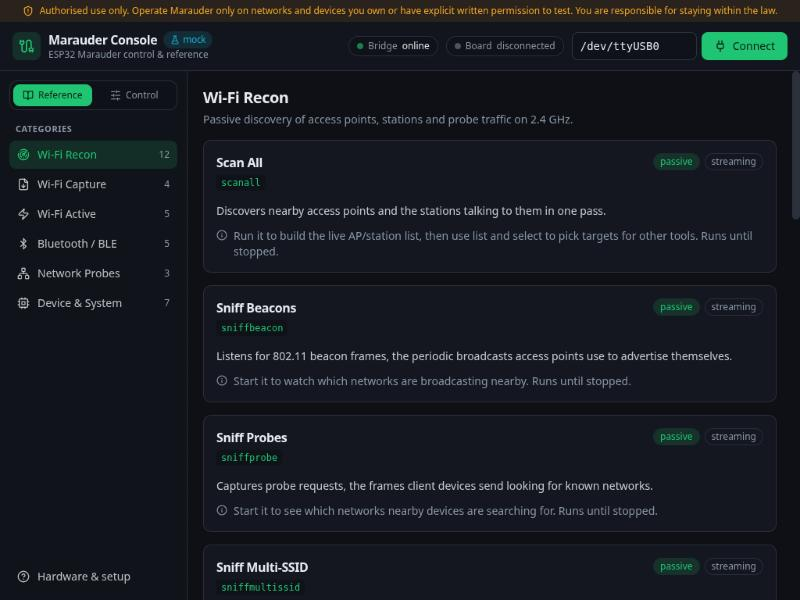
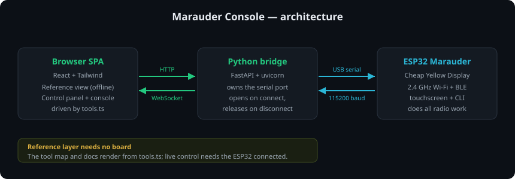
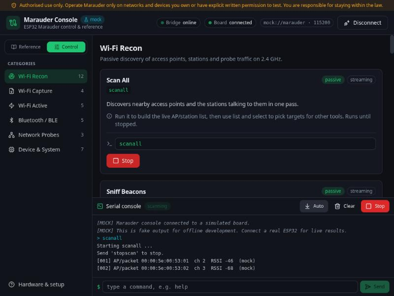
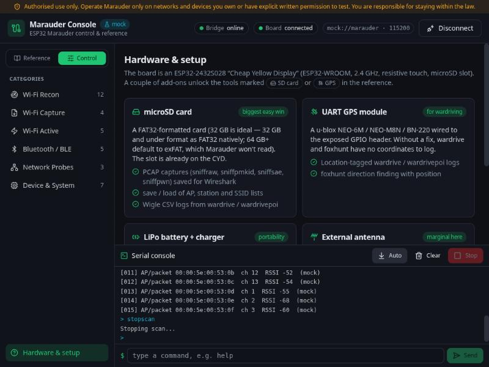

# Marauder Console

[](https://github.com/baverrr/marauder-console/actions/workflows/ci.yml)
[](https://github.com/baverrr/marauder-console/actions/workflows/codeql.yml)
[](LICENSE)

A local, self-hosted web UI for an **ESP32 running [ESP32 Marauder](https://github.com/justcallmekoko/ESP32Marauder)**
firmware — in this case a **Cheap Yellow Display** (ESP32‑2432S028, 2.4 GHz Wi‑Fi + BLE, resistive
touchscreen) wired to a Linux box over USB serial. It is two things at once:

1. **A reference / tool map** — a clean, annotated catalogue of every Marauder command: what it does, its
   syntax and how to use it. This layer works **with no board attached**.
2. **A live control panel** — it sends commands to the board over the serial port and streams the output
   back into a browser console in real time. This layer **needs the ESP32 connected**.

Marauder has no built-in web server; its only interfaces are the device's touchscreen and a serial
command line. This project puts a modern UI in front of that serial CLI, running entirely on your own
machine — nothing is sent anywhere.

> [!IMPORTANT]
> **Authorised use only.** Marauder is a security-testing tool. Use it only on networks and devices you
> own or have explicit written permission to test, and stay within the law in your jurisdiction. The
> commands that **transmit** (deauth, beacon/probe, AP spoofing, BLE spam) are gated in the UI behind a
> per-session authorisation acknowledgement, and a permanent banner is shown at the top. This project is
> independent and is not affiliated with the Marauder project.

<p align="center">
  
</p>

## Why two layers

All the radio work happens on the ESP32 — the UI can't run any Marauder function on its own. So the two
layers are deliberately split:

- The **reference** is pure content (it renders from a single data file, [`frontend/src/tools.ts`](frontend/src/tools.ts)),
  so you can browse and learn the whole command set offline, before the board is ever plugged in.
- The **control panel** talks to a small Python **bridge** that owns the serial port and relays commands
  and output. Connect the board, and the same tool cards gain a **Run** control.

<p align="center">
  
</p>

```
Browser SPA ──HTTP (commands) + WebSocket (live serial)──▶ Python bridge ──pyserial──▶ ESP32 Marauder
```

## Features

- **Full annotated tool map** — Wi‑Fi recon, Wi‑Fi capture, Wi‑Fi active (transmit), Bluetooth/BLE,
  network probes and device/system commands, each with a high-level summary, how-to and exact syntax.
- **One source of truth** — [`tools.ts`](frontend/src/tools.ts) drives *both* the reference docs and the
  Run controls, so they can never drift apart.
- **Live serial console** — streamed over a WebSocket, colour-coded, with autoscroll, a free-form command
  box and a **Stop** button wired to `stopscan`.
- **Safe streaming** — scans and sniffs (`scanall`, `sniff*`, `wardrive`, …) run until stopped; the UI
  tracks which command is running and shows Stop. It also surfaces "board busy" because the device's
  touchscreen and serial share state.
- **On-demand port ownership** — the bridge opens `/dev/ttyUSB0` only while you're *connected* and
  **releases it on Disconnect**, so your flashing script (or the board's own screen) can use the port the
  rest of the time. The port is single-consumer.
- **Authorisation gating** — transmitting (`active`) tools are disabled until you acknowledge, once per
  session, that you're authorised to test the target.
- **Hardware "Requires" badges** — tools that need an **SD card** (PCAP captures, `save`/`load`, wardrive
  logs) or a **GPS** module (`wardrive`, `wardrivepoi`, `foxhunt` location) are flagged, with a built-in
  **Hardware & setup** page.
- **Mock mode** — a simulated board (`--mock`) lets you run and develop the whole app, streaming included,
  with no hardware.

<p align="center">
  
</p>

## Hardware & accessories

The board is an ESP32‑WROOM (2.4 GHz only) with a built-in microSD slot and touchscreen. Two cheap add-ons
unlock most of the "Requires" tools:

| Add-on | Unlocks | Notes |
|---|---|---|
| **microSD card** | `.pcap` captures (`sniffraw`, `sniffpmkid`, `sniffsae`, `sniffpwn`), `save`/`load`, Wigle `wardrive` logs | 32 GB is ideal — 32 GB and under format as **FAT32** natively; 64 GB+ default to exFAT, which Marauder won't read. Slot is already on the CYD. |
| **UART GPS module** | Location for `wardrive`, `wardrivepoi`, `foxhunt` | e.g. u‑blox NEO‑6M / NEO‑M8N / BN‑220, wired to the exposed GPIO header. Without a fix, location fields stay empty. |
| LiPo battery + TP4056 | Portability for field use | Some CYD revisions have no onboard charger — check yours before wiring. |

**Not supported by Marauder** (don't chase these): 5 GHz Wi‑Fi (the radio is 2.4 GHz only), and sub‑GHz /
CC1101 / NRF24 (Flipper-Zero territory). BLE tools use the ESP32's built-in radio — no add-on needed.

The in-app **Hardware & setup** page covers all of this:

<p align="center">
  
</p>

## Requirements

- Linux with **Python 3.11+** and **Node.js 18+** (for building the frontend).
- An ESP32 running Marauder on a serial device (default `/dev/ttyUSB0`, 115200 baud) — only for live
  control. Your user needs access to the port, usually via the `dialout` group.

## Install

Clone, then run the installer from the checkout (user-local, no root):

```bash
./install.sh
```

It creates a Python venv, installs the bridge's dependencies, builds the React frontend into
`frontend/dist`, and installs a `marauder-console` launcher in `~/.local/bin`.

To also install and start a **systemd user service** that keeps the bridge running:

```bash
./install.sh --service
```

If opening `/dev/ttyUSB0` fails, add yourself to the `dialout` group (then log out and back in):

```bash
sudo usermod -aG dialout "$USER"
```

## Run

```bash
marauder-console
```

This starts the bridge (if it isn't already up) and opens <http://127.0.0.1:8200>. Browse the tool map
right away; to use the control panel, plug in the board and click **Connect**.

No board handy? Run against a simulated one:

```bash
marauder-console --mock
```

### Development

Run the bridge and the Vite dev server separately (the dev server proxies `/api` and `/ws` to the bridge):

```bash
# terminal 1 — bridge (mock needs no hardware)
./venv/bin/python bridge.py serve --mock

# terminal 2 — frontend with hot reload
cd frontend && npm run dev
```

Run the bridge tests (all against the mock serial source — no hardware):

```bash
./venv/bin/python -m pytest
```

## Configuration

The bridge takes flags (see `bridge.py serve --help`):

| Flag | Default | Meaning |
|---|---|---|
| `--host` | `127.0.0.1` | Bind address for the UI (localhost by default). |
| `--port` | `8200` | HTTP/WebSocket port for the UI. |
| `--serial-port` | `/dev/ttyUSB0` | Default ESP32 serial device. |
| `--baud` | `115200` | Serial baud rate. |
| `--mock` | off | Simulate a board; no hardware needed. |

The serial port can also be changed per-session in the top bar before connecting.

## Project layout

```
marauder-console/
├── bridge.py                 # FastAPI bridge: HTTP + WebSocket, owns the serial port
├── serial_source.py          # Real (pyserial-asyncio) and mock serial sources
├── test_bridge.py            # Tests, all against the mock source
├── requirements.txt
├── install.sh                # User-local installer (venv + frontend build + launcher)
├── packaging/
│   ├── marauder-console.service.in   # systemd --user service template
│   └── marauder-console.in           # launcher template
├── frontend/
│   └── src/
│       ├── tools.ts          # THE tool map — drives reference + control
│       ├── App.tsx
│       ├── lib/              # bridge client (HTTP+WS), command builder
│       └── components/       # TopBar, CategoryNav, ToolCard, SerialConsole, HardwarePanel, ui/
└── docs/
    ├── architecture.svg
    └── images/               # UI screenshots
```

## How it works

| Concern | Approach |
|---|---|
| Serial ownership | The Python bridge is the single owner of the port. The browser never touches it. The port is opened on **Connect** and closed on **Disconnect**, keeping `/dev/ttyUSB0` free otherwise. |
| Live output | The bridge reads serial lines and fans them out to every connected browser over a WebSocket, with a short replay buffer for late joiners. |
| Commands | Sent over plain HTTP `POST /api/command`; the bridge also tracks running/stopped state for streaming commands. |
| Reference offline | The tool map is static data compiled into the frontend, so the docs render with the bridge disconnected (or no board at all). |
| Mock board | `serial_source.MockSerialSource` fakes Marauder's `help`/`info` and streams generic placeholder lines for scan/sniff commands until `stopscan`. |

## License & legal

- **License:** MIT — see [LICENSE](LICENSE). You may use, modify and redistribute the code under those terms.
- **Terms and Conditions:** [TERMS.md](TERMS.md) — how you may operate the app, the **authorised-use** and
  legal-compliance requirements for a transmitting security tool, no-warranty and liability terms.
- **Privacy Policy:** [PRIVACY.md](PRIVACY.md) — the app runs entirely on your own computer, collects
  nothing, and sends nothing to the author.

## Notes & disclaimer

- All example output, addresses and identifiers in the mock and the docs are **documentation placeholders**
  (RFC 5737 IPs like `192.0.2.x`, RFC 7042 MACs like `00:00:5e:00:53:xx`).
- Provided **as is**, for authorised security testing and education. You are responsible for how you use it;
  see the [Terms and Conditions](TERMS.md).
