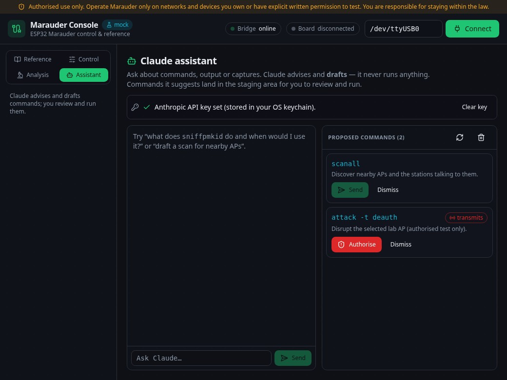

# Marauder Console

[](https://github.com/baverrr/marauder-console/actions/workflows/ci.yml)
[](https://github.com/baverrr/marauder-console/actions/workflows/codeql.yml)
[](LICENSE)

A local, self-hosted web UI for an **ESP32 running [ESP32 Marauder](https://github.com/justcallmekoko/ESP32Marauder)**
firmware — in this case a **Cheap Yellow Display** (ESP32‑2432S028, 2.4 GHz Wi‑Fi + BLE, resistive
touchscreen) wired to a Linux box over USB serial. It is two things at once:

1. **A reference / tool map** — a clean, annotated catalogue of every Marauder command: what it does, its
   syntax and how to use it. This layer works **with no board attached**.
2. **A live control panel** — it sends commands to the board over the serial port and streams the output
   back into a browser console in real time. This layer **needs the ESP32 connected**.

Marauder has no built-in web server; its only interfaces are the device's touchscreen and a serial
command line. This project puts a modern UI in front of that serial CLI, running entirely on your own
machine — nothing is sent anywhere.

> [!IMPORTANT]
> **Authorised use only.** Marauder is a security-testing tool. Use it only on networks and devices you
> own or have explicit written permission to test, and stay within the law in your jurisdiction. The
> commands that **transmit** (deauth, beacon/probe, AP spoofing, BLE spam) are gated in the UI behind a
> per-session authorisation acknowledgement, and a permanent banner is shown at the top. This project is
> independent and is not affiliated with the Marauder project.

<p align="center">
  
</p>

## Why two layers

All the radio work happens on the ESP32 — the UI can't run any Marauder function on its own. So the two
layers are deliberately split:

- The **reference** is pure content (it renders from a single data file, [`frontend/src/tools.ts`](frontend/src/tools.ts)),
  so you can browse and learn the whole command set offline, before the board is ever plugged in.
- The **control panel** talks to a small Python **bridge** that owns the serial port and relays commands
  and output. Connect the board, and the same tool cards gain a **Run** control.

<p align="center">
  
</p>

```
Browser SPA ──HTTP (commands) + WebSocket (live serial)──▶ Python bridge ──pyserial──▶ ESP32 Marauder
```

## Features

- **Full annotated tool map** — Wi‑Fi recon, Wi‑Fi capture, Wi‑Fi active (transmit), Bluetooth/BLE,
  network probes and device/system commands, each with a high-level summary, how-to and exact syntax.
  The catalogue tracks the device's own serial command set, including admin (channel, settings, reboot,
  firmware update), MAC randomise/clone, and the GPS tools (`gpsdata`, `nmea`, `gpspoi`, `gpstracker`,
  `geofence`).
- **One source of truth** — [`tools.ts`](frontend/src/tools.ts) drives *both* the reference docs and the
  Run controls, so they can never drift apart.
- **Live serial console** — streamed over a WebSocket, colour-coded, with autoscroll, a free-form command
  box and a **Stop** button wired to `stopscan`.
- **Session history (PC-side)** — under the **Analysis** tab, every connect→disconnect span is saved
  locally as a transcript (commands + output) you can reopen and read offline, board unplugged.
- **Capture library + PCAP viewer (PC-side)** — also under **Analysis**: browse `.pcap`/CSV/log files
  copied from the SD card, and get a read-only packet summary of a capture (frames, span, SSIDs and
  BSSIDs seen) from a dependency-free parser. Inspection only — no injection, nothing transmitted.
- **Wardrive map (PC-side)** — plots the located access points from a Wigle wardrive CSV on an offline,
  self-contained point map (coloured by signal strength, with per-point details). No map tiles are
  fetched, so your route is never sent anywhere; rows without a GPS fix are skipped.
- **Find My radar (PC-side)** — under the **Analysis** tab, turns a BLE sniff into a live, nearest-first
  list of detected devices with an estimated distance (from signal strength), a proximity band
  (Immediate / Near / Far) and a closer/farther trend, plus a per-device homing panel. Distance from RSSI
  is rough by nature, so it leans on bands and trend over false precision; the 1 m reference and
  environment are adjustable. Parsing only — the ESP32 does the sensing. A **Scan for** selector picks
  what to listen for: **Find My** (`sniffbt -t airtag`), **iBeacon**, **Flipper**, **Flock**, **Cameras**,
  or **All BLE** (`recon ble` — every BLE device in range). A **Raw** toggle (on by default) makes Start
  request the custom raw-capture firmware's advert dump (`… -raw`, see
  [`firmware/custom-rawadv/`](firmware/custom-rawadv)); the radar then also decodes each device's raw BLE
  advertisement and **says what it is** — a Find My tracker (with battery level and whether it's
  *separated* from its owner or the owner's nearby), an iBeacon (UUID / major / minor), AirPods / Beats, a
  Tile, a **likely camera** (matched by its advertised name — Reolink, Wyze, Ring, Flock… — with a
  confidence), or a named vendor device — from the Apple (`0x004C`) continuity messages, company id and service
  UUIDs. Each device shows an identity chip in the list (separated trackers flagged in amber, the "is
  something following me" case), with the decoded Find My status byte in the homing panel. Every scan
  mode — including All BLE (`recon ble -raw`) — supports the raw decode with the custom firmware. With
  stock firmware those raw bytes aren't available (turn Raw off) and the radar works from signal strength
  alone.
- **Camera scan (PC-side)** — also under the **Analysis** tab, a network sweep that finds IP cameras on
  your local network and lists each one's **address, vendor and open ports**. It runs from the PC with no
  board needed, using **ONVIF** discovery and **mDNS** plus a quick check of known camera ports
  (RTSP 554, Dahua, Hikvision and friends), and scores each host with a confidence and the reasons behind
  it. It **actively probes your network**, so it only runs when you press **Scan my network** — never on
  its own, and the assistant can't trigger it. Where the radar finds cameras *broadcasting* nearby over
  BLE, this finds the ones *on your network*.
- **Claude assistant — advise & draft only** — under the **Assistant** tab, chat with Claude about
  commands, output and captures. It reads live status and your capture files (read-only) and *proposes*
  commands into a staging area; it never runs them — you review each one (with a **transmits** flag on
  anything that emits RF) and run it yourself through the normal authorisation. The assistant has no tool
  that can execute or transmit. Your Anthropic API key is stored in the OS keychain (set it in the tab),
  never in the repo or a log.
- **Safe streaming** — scans and sniffs (`scanall`, `sniff*`, `wardrive`, …) run until stopped; the UI
  tracks which command is running and shows Stop. It also surfaces "board busy" because the device's
  touchscreen and serial share state.
- **On-demand port ownership** — the bridge opens `/dev/ttyUSB0` only while you're *connected* and
  **releases it on Disconnect**, so your flashing script (or the board's own screen) can use the port the
  rest of the time. The port is single-consumer.
- **Authorisation gating** — transmitting (`active`) tools are disabled until you acknowledge, once per
  session, that you're authorised to test the target.
- **Hardware "Requires" badges** — tools that need an **SD card** (PCAP captures, `save`/`load`, wardrive
  logs) or a **GPS** module (`wardrive`, `wardrivepoi`, `foxhunt`, `gpsdata`/`nmea` location) are flagged, with a built-in
  **Hardware & setup** page.
- **Mock mode** — a simulated board (`--mock`) lets you run and develop the whole app, streaming included,
  with no hardware.

<p align="center">
  
</p>

<p align="center">
  
</p>

## Desktop app (in progress)

A native **desktop build** is being added: a [Tauri](https://tauri.app/) window around this same UI, with
the Python bridge bundled as a sidecar (no browser, no separate install), a **Claude-enabled assistant**
that explains commands and *drafts* (never runs) them, and expanded tools — more of the Marauder command
set plus PC-side analysis (PCAP viewer, wardrive map, SD capture library, session history). The web app
above keeps working unchanged; the desktop build is additive.

Install it for your user (builds the release binary, adds a launcher + themed icon, and on KDE Plasma pins
it to the taskbar):

```bash
bash scripts/install-desktop.sh
```

To build a distributable bundle instead (AppImage + `.deb`, with the Python bridge frozen in as a
sidecar — no `./venv` needed on the target machine):

```bash
bash scripts/build-bundle.sh
```

> **Building the binary by hand?** Use the Tauri CLI (`frontend/node_modules/.bin/tauri build`), **not** a
> bare `cargo build` — the latter produces a *dev-mode* binary that loads the Vite dev server
> (`localhost:5173`) instead of the bundled UI, so it shows "Could not connect to localhost" when no dev
> server is running. The scripts above already build the right way.

Pushing a `v*` tag runs [`release.yml`](.github/workflows/release.yml), which builds the bundle in CI and
attaches the `.deb`, the AppImage (best-effort) and a firmware + flasher zip to the GitHub release — so the
console and the matching ESP32 Marauder firmware ship together. The artifacts are built against
webkit2gtk-4.1, so they need a recent distro (Ubuntu 24.04+ / equivalent). The release build installs its
Python packages from a hash-locked file, [`packaging/requirements-release.txt`](packaging/requirements-release.txt),
and runs with a read-only token; only the final step that attaches the files gets write access. After
changing `requirements.txt`, regenerate the lock with the `uv pip compile` command at the top of
[`packaging/requirements-release.in`](packaging/requirements-release.in).

- Roadmap and phases: [`docs/DESKTOP_PLAN.md`](docs/DESKTOP_PLAN.md)
- Run modes and layout: [`docs/desktop-dev.md`](docs/desktop-dev.md)

## Hardware & accessories

The board is an ESP32‑WROOM (2.4 GHz only) with a built-in microSD slot and touchscreen. Two cheap add-ons
unlock most of the "Requires" tools:

| Add-on | Unlocks | Notes |
|---|---|---|
| **microSD card** | `.pcap` captures (`sniffraw`, `sniffpmkid`, `sniffsae`, `sniffpwn`), `save`/`load`, Wigle `wardrive` logs | 32 GB is ideal — 32 GB and under format as **FAT32** natively; 64 GB+ default to exFAT, which Marauder won't read. Slot is already on the CYD. |
| **UART GPS module** | Location for `wardrive`, `wardrivepoi`, `foxhunt` | e.g. u‑blox NEO‑6M / NEO‑M8N / BN‑220, wired to the exposed GPIO header. Without a fix, location fields stay empty. |
| LiPo battery + TP4056 | Portability for field use | Some CYD revisions have no onboard charger — check yours before wiring. |

**Not supported by Marauder** (don't chase these): 5 GHz Wi‑Fi (the radio is 2.4 GHz only), and sub‑GHz /
CC1101 / NRF24 (Flipper-Zero territory). BLE tools use the ESP32's built-in radio — no add-on needed.

The in-app **Hardware & setup** page covers all of this:

<p align="center">
  
</p>

## Requirements

- Linux with **Python 3.11+** and **Node.js 18+** (for building the frontend).
- An ESP32 running Marauder on a serial device (default `/dev/ttyUSB0`, 115200 baud) — only for live
  control. Your user needs access to the port, usually via the `dialout` group.

## Install

Clone, then run the installer from the checkout (user-local, no root):

```bash
./install.sh
```

It creates a Python venv, installs the bridge's dependencies, builds the React frontend into
`frontend/dist`, and installs a `marauder-console` launcher in `~/.local/bin`.

To also install and start a **systemd user service** that keeps the bridge running:

```bash
./install.sh --service
```

If opening `/dev/ttyUSB0` fails, add yourself to the `dialout` group (then log out and back in):

```bash
sudo usermod -aG dialout "$USER"
```

## Run

```bash
marauder-console
```

This starts the bridge (if it isn't already up) and opens <http://127.0.0.1:8200>. Browse the tool map
right away; to use the control panel, plug in the board and click **Connect**.

No board handy? Run against a simulated one:

```bash
marauder-console --mock
```

### Development

Run the bridge and the Vite dev server separately (the dev server proxies `/api` and `/ws` to the bridge):

```bash
# terminal 1 — bridge (mock needs no hardware)
./venv/bin/python bridge.py serve --mock

# terminal 2 — frontend with hot reload
cd frontend && npm run dev
```

Run the bridge tests (all against the mock serial source — no hardware):

```bash
./venv/bin/python -m pytest
```

## Configuration

The bridge takes flags (see `bridge.py serve --help`):

| Flag | Default | Meaning |
|---|---|---|
| `--host` | `127.0.0.1` | Bind address for the UI (localhost by default). |
| `--port` | `8200` | HTTP/WebSocket port for the UI. |
| `--serial-port` | `/dev/ttyUSB0` | Default ESP32 serial device. |
| `--baud` | `115200` | Serial baud rate. |
| `--mock` | off | Simulate a board; no hardware needed. |

The serial port can also be changed per-session in the top bar before connecting.

### Behind a reverse proxy

The bridge binds to loopback and, as a DNS-rebinding defence, only accepts requests whose `Host` is a
loopback name (`localhost` / `127.0.0.1`) — so reaching it through a proxy under another name (e.g.
`https://marauder.home.arpa`) otherwise fails with **"Invalid host header"**. To serve it under such a
name, set the `MARAUDER_PUBLIC_HOST` environment variable to that hostname (comma-separated for several);
it's then accepted as a `Host` header and as a browser origin (HTTP, CORS and the WebSocket upgrade). It's
opt-in and empty by default, so the bridge stays loopback-only unless you set it. Point the proxy at
`127.0.0.1:8200` and forward WebSocket upgrades; no `Host`/`Origin` rewriting is needed. For the systemd
user service, add it as `Environment=MARAUDER_PUBLIC_HOST=marauder.home.arpa`.

Any `POST`, `PUT` or `DELETE` that carries a browser `Origin` outside that list (the desktop shell, a
loopback dev server, or a `MARAUDER_PUBLIC_HOST`) is refused with **403**, so a web page open in another tab
can't connect, stop or disconnect the board or start a camera scan. Requests with no `Origin`, such as
`curl`, are unaffected.

## Project layout

```
marauder-console/
├── bridge.py                 # FastAPI bridge: HTTP + WebSocket, owns the serial port
├── serial_source.py          # Real (pyserial-asyncio) and mock serial sources
├── test_bridge.py            # Tests, all against the mock source
├── requirements.txt
├── install.sh                # User-local installer (venv + frontend build + launcher)
├── packaging/
│   ├── marauder-console.service.in   # systemd --user service template
│   ├── marauder-console.in           # launcher template
│   ├── requirements-release.in       # release build's Python inputs
│   └── requirements-release.txt      # …locked with hashes (generated by uv)
├── frontend/
│   └── src/
│       ├── tools.ts          # THE tool map — drives reference + control
│       ├── App.tsx
│       ├── lib/              # bridge client (HTTP+WS), command builder
│       └── components/       # TopBar, CategoryNav, ToolCard, SerialConsole, HardwarePanel, ui/
└── docs/
    ├── architecture.svg
    └── images/               # UI screenshots
```

## How it works

| Concern | Approach |
|---|---|
| Serial ownership | The Python bridge is the single owner of the port. The browser never touches it. The port is opened on **Connect** and closed on **Disconnect**, keeping `/dev/ttyUSB0` free otherwise. |
| Live output | The bridge reads serial lines and fans them out to every connected browser over a WebSocket, with a short replay buffer for late joiners. |
| Commands | Sent over plain HTTP `POST /api/command`; the bridge also tracks running/stopped state for streaming commands. A command must be one line: newlines and other control characters are rejected (400), so one request, or one staged proposal, can never become two commands on the board. |
| Reference offline | The tool map is static data compiled into the frontend, so the docs render with the bridge disconnected (or no board at all). |
| Mock board | `serial_source.MockSerialSource` fakes Marauder's `help`/`info` and streams generic placeholder lines for scan/sniff commands until `stopscan`. |

## Credits

- **[ESP32 Marauder](https://github.com/justcallmekoko/ESP32Marauder) firmware** by
  [justcallmekoko](https://github.com/justcallmekoko) — the upstream project this console is a client
  for. All of the Wi-Fi and Bluetooth functionality lives in that firmware, running on the ESP32;
  Marauder Console only sends it commands and shows its output.

Marauder Console is an independent interface and is not affiliated with, endorsed by, or supported by
the ESP32 Marauder project. "ESP32 Marauder" and related names belong to their respective owners.

The matching firmware is **bundled** (ESP32 Marauder `v1.20.0` for the Cheap Yellow Display,
ESP32‑2432S028), redistributed unmodified under its MIT license, so the board and the console ship
together. Flash it with:

```bash
bash scripts/flash-firmware.sh --port /dev/ttyUSB0
```

The flasher verifies each file's `sha256`, won't run while the serial port is busy, does a read-only check
and asks for confirmation before writing. See [`firmware/`](firmware/) (binaries, `manifest.json`, upstream
license) and [`THIRD_PARTY_NOTICES.md`](THIRD_PARTY_NOTICES.md).

> [!NOTE]
> **Optional raw BLE capture.** The bundled firmware only prints parsed BLE fields. If you want the raw
> advertisement bytes (to decode names, Apple Find My data and service UUIDs in the radar), a small opt-in
> source patch adds a `sniffbt -t airtag -raw` command — build and flash instructions are in
> [`firmware/custom-rawadv/`](firmware/custom-rawadv). That's a firmware you build yourself; the bundled
> binaries stay byte-for-byte upstream and are untouched.
>
> Two more opt-in patches build the same way: a tap-to-wake idle **screensaver**
> ([`firmware/custom-screensaver/`](firmware/custom-screensaver)) and a **solid green board LED**, with an
> option to alternate purple and green once a second ([`firmware/custom-led/`](firmware/custom-led)).

## License & legal

- **License:** MIT — see [LICENSE](LICENSE). You may use, modify and redistribute the code under those terms.
- **Terms and Conditions:** [TERMS.md](TERMS.md) — how you may operate the app, the **authorised-use** and
  legal-compliance requirements for a transmitting security tool, no-warranty and liability terms.
- **Privacy Policy:** [PRIVACY.md](PRIVACY.md) — the app runs entirely on your own computer, collects
  nothing, and sends nothing to the author.
- **Third-party notices:** [THIRD_PARTY_NOTICES.md](THIRD_PARTY_NOTICES.md) — the bundled ESP32 Marauder
  firmware (MIT) and the `esptool` flashing tool (GPL-2.0, installed on demand, not redistributed).

## Notes & disclaimer

- All example output, addresses and identifiers in the mock and the docs are **documentation placeholders**
  (RFC 5737 IPs like `192.0.2.x`, RFC 7042 MACs like `00:00:5e:00:53:xx`).
- Provided **as is**, for authorised security testing and education. You are responsible for how you use it;
  see the [Terms and Conditions](TERMS.md).
