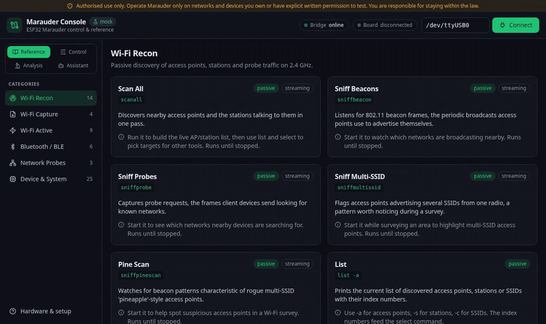

# Marauder Console

[](https://github.com/baverrr/marauder-console/actions/workflows/ci.yml)
[](LICENSE)

A dashboard for controlling an ESP32 Marauder board from your computer. Pick a tool, press Run, and watch the results appear live.

<p align="center">
  
</p>

> [!TIP]
> No board yet? Run `marauder-console --mock` to try everything with a pretend board.

> [!IMPORTANT]
> Marauder is a security testing tool. Only use it on networks and devices you own or have written permission to test.

**[What it does](#what-it-does)** · **[What you need](#what-you-need)** · **[Install](#install)** · **[How to use it](#how-to-use-it)** · **[Help](#help)**

## What it does

- **Explains every command.** A built-in guide says what each Marauder tool does and how to use it. Works with no board plugged in.
- **Runs commands with one click.** Plug in the board, press Connect, and each tool gets a Run button.
- **Shows live results.** Output streams into the app as it happens, with a Stop button.
- **Keeps a history.** Every session is saved on your computer so you can read it later.
- **Finds nearby trackers and cameras.** A radar view lists Bluetooth devices around you, like AirTags, with a rough distance.
- **Optional AI helper.** Ask Claude about a command or a result. It can suggest commands, but you always press Run yourself.
- **Stays on your computer.** Nothing is sent anywhere, except your questions to Claude if you use the helper.

<table>
  <tr>
    <td></td>
    <td></td>
  </tr>
  <tr>
    <td align="center">The command guide</td>
    <td align="center">The AI helper</td>
  </tr>
</table>

## What you need

- A Linux computer
- Python 3.11 or newer, and Node.js 18 or newer
- An ESP32 board running Marauder, plugged in by USB (only needed to run commands)

## Install

1. Download the project:

   ```bash
   git clone https://github.com/baverrr/marauder-console.git
   cd marauder-console
   ```

2. Run the installer. It sets everything up for your user only, no admin needed:

   ```bash
   ./install.sh
   ```

3. Let your account use the USB port, then log out and back in:

   ```bash
   sudo usermod -aG dialout "$USER"
   ```

4. Start it:

   ```bash
   marauder-console
   ```

   The app opens in your browser at <http://127.0.0.1:8200>.

## How to use it

1. **Browse.** Pick a category on the left to read about each tool.
2. **Connect.** Plug in the board and press **Connect** at the top right.
3. **Run.** Open the **Control** tab and press **Run** on any tool. Press **Stop** to end a scan.
4. **Look back.** The **Analysis** tab has your saved sessions, captures and the tracker radar.

Tools that send radio signals stay locked until you confirm you have permission to test.

<details>
<summary><b>Extra hardware that unlocks more tools</b></summary>

| Add-on | What it adds |
|---|---|
| microSD card (32 GB or smaller) | Saving captures and logs |
| GPS module | Location for wardriving |
| Battery | Using the board away from your desk |

The board only does 2.4 GHz Wi-Fi and Bluetooth. It can't do 5 GHz Wi-Fi.


</details>

## Help

**"Permission denied" when connecting.** Do step 3 of Install, then log out and back in.

**The board says it's busy.** Close any other program using the USB port, like a flashing tool.

**I need to install Marauder on the board.** The right firmware is included. Run:

```bash
bash scripts/flash-firmware.sh --port /dev/ttyUSB0
```

<details>
<summary><b>For developers</b></summary>

- Settings: run `./venv/bin/python bridge.py serve --help`
- Desktop app (in progress): [docs/desktop-dev.md](docs/desktop-dev.md)
- How it fits together: [architecture diagram](docs/diagrams/architecture.svg)
- Run the tests: `./venv/bin/python -m pytest`
- Custom firmware add-ons: [firmware/](firmware/)
- Security check: `bandit -r .` reads its settings from `.bandit`, which says why each one is there.
</details>

## License

MIT. See [LICENSE](LICENSE), plus the [Terms](TERMS.md) and [Privacy](PRIVACY.md) pages.

This app is not part of the [ESP32 Marauder](https://github.com/justcallmekoko/ESP32Marauder) project. All the radio work is done by that firmware.
